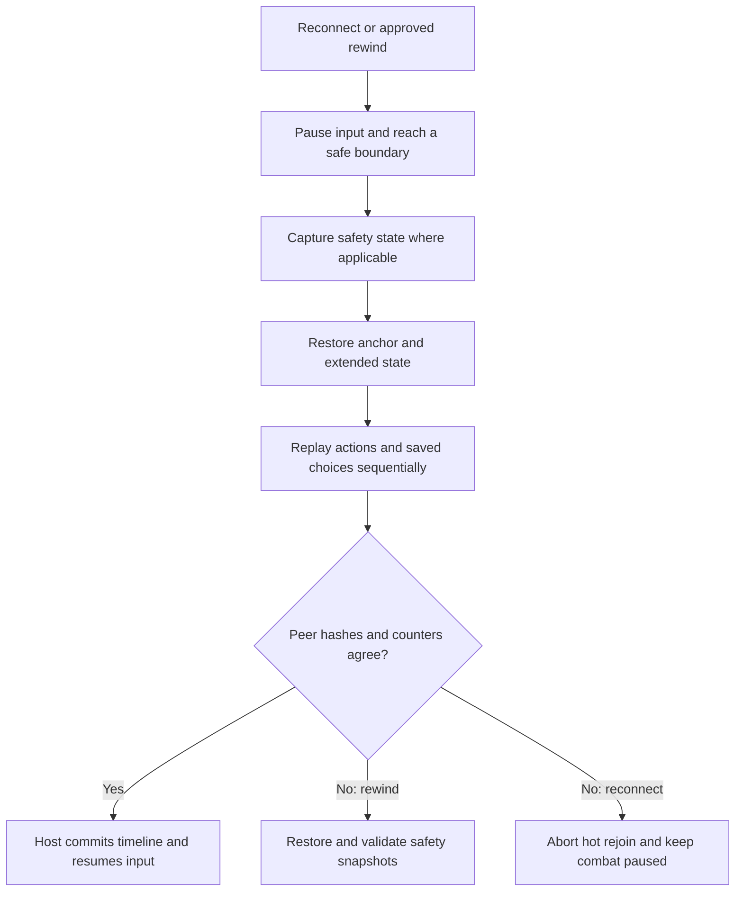

# CombatReconnect

**Deterministic combat replay, co-op reconnection, and transactional rewind for Slay the Spire 2.**

[中文说明](README.zh-CN.md) · [Build & test guide](docs/TESTING.md) · [Multiplayer regression matrix](docs/MULTIPLAYER_TEST_MATRIX.md)

CombatReconnect is a C# game mod by **Ziheng Zhou**. It lets a disconnected co-op player return to an ongoing combat and lets players rewind to an earlier player turn. The engineering challenge is restoring a state that every peer can continue simulating consistently, including player identity, recorded choices, dynamic creatures, and future random outcomes.

**Status: experimental.** The source manifest is `0.6.32`, with protocol `63-monster-runtime-state`. Multiplayer implementation is present; end-to-end correctness requires paired host/client evidence. Build success and tooling tests alone do not establish multiplayer reliability.

## Features

- **Reconnect during combat:** the host reserves a disconnected non-host player's seat and pauses combat; the client returns through Join Friend or a Steam invitation.
- **Rewind a player turn:** use **F4** or the draggable rewind button. Right-click to select a retained turn; the default history holds ten player turns.
- **Coordinate multiplayer rewind:** other participants must approve within 20 seconds. The host coordinates a safe boundary, validates state, and commits after peer validation.
- **Recover from failed rewind:** peers restore pre-operation safety snapshots; the host validates recovery acknowledgements before resuming play.
- **Inspect replay locally:** **F6**, after at least one completed round in single-player combat, exercises message serialization, replay validation, and safety recovery. Results appear as `SELFTEST PASS` or `SELFTEST FAIL` in the mod log.

All participants need the same game/mod versions and compatible mod sets. Install STS2-RitsuLib through Steam Workshop; it supplies settings, hotkeys, and sidecar transport.

## Architecture

The mod restores an anchor and replays the host's confirmed inputs through the game's native action pipeline.



| Component | Responsibility |
| --- | --- |
| [CombatReconnectMod.cs](CombatReconnectMod.cs) | Native join integration, combat loading, restoration, and runtime patches |
| [TurnReplaySystem.cs](TurnReplaySystem.cs) | Turn anchors, input ledger, sequential replay, and timeline branching |
| [MultiplayerRewind.cs](MultiplayerRewind.cs) | Voting, transaction coordination, validation, commit, and recovery |
| [ReplayProtocol.cs](ReplayProtocol.cs) / [SidecarReplayTransport.cs](SidecarReplayTransport.cs) | Replay messages, serialization, and transport |
| [ExtendedReconnectMessage.cs](ExtendedReconnectMessage.cs) | State outside the native snapshot, including counters and map history |
| [RewindTransactionSafety.cs](RewindTransactionSafety.cs) | Safety snapshots, input gating, and replay action/choice hooks |
| [CombatHistoryState.cs](CombatHistoryState.cs) / [MonsterMoveStateSupport.cs](MonsterMoveStateSupport.cs) | History, detached creature references, and monster runtime state |
| [RewindSelfTest.cs](RewindSelfTest.cs) / [tools/](tools/) | In-game integration self-test, packaging, and paired-log diagnostics |

### Replay invariants

- Each peer retains its real local network identity; recorded actions retain their original owner.
- Actions, hooks, saved choices, and resumptions complete sequentially. Synthetic Ready actions are suppressed when the recording already contains them.
- Ordinary rewind restores the round-one anchor and replays inputs without recreating the original encounter roster to reach a later turn.
- Validation includes inputs to future randomness, even when absent from the game's normal checksum.
- Recovery validates round, side, player turns, local card ownership, counters, RNG, and state hash before resuming.

## Debugging case: matching checksums, different next encounters

A reconnect could pass the current combat checksum yet produce different randomized monsters in the next combat. Synthetic combat entry appended an extra map-history entry.

`RunState.TotalFloor` is derived from map-history counts. An encounter's private RNG seed depends on the run seed, `TotalFloor`, and encounter ID hash; normal run-RNG counters did not expose the difference. The extra entry therefore changed future randomness while leaving the current combat apparently consistent.

The implementation records per-act history counts in extended state and fingerprints. After synthetic entry, it removes an entry only if the current act has exactly one extra final entry referencing the anchor encounter. It then revalidates every act count and `TotalFloor`; other shapes abort reconnect.

This illustrates why a replay boundary must capture inputs to future randomness as well as visible combat state. Full regression still requires reconnecting in combat one and comparing both peers' roster, order, HP, and opening checksum in combat two.

## Build and install

Requirements: **.NET 9 SDK**, a local **Slay the Spire 2** installation, and NuGet access for **STS2.RitsuLib 0.4.59**. The project references `sts2.dll`, `0Harmony.dll`, and `GodotSharp.dll` from the game; those proprietary assemblies are not included.

```bash
git clone https://github.com/Alex-ZhouZiheng/CombatReconnect.git
cd CombatReconnect
dotnet build -c Release -p:STS2GameDir="/path/to/Slay the Spire 2"
```

The project resolves macOS ARM64 or Windows x86_64 game-data paths. For another layout, pass `-p:STS2GameDataDir="/path/to/game-data"`. Packaging and diagnostic scripts target macOS/zsh; this does not imply cross-platform runtime verification.

On macOS, with the game closed:

```bash
export STS2_GAME_DIR="$HOME/Library/Application Support/Steam/steamapps/common/Slay the Spire 2"
tools/combat-reconnect.sh release
tools/combat-reconnect.sh install
tools/combat-reconnect.sh verify-installed
```

`release` builds the DLL, creates a Godot PCK using the installed game runtime, packages the mod, and checks package/source consistency. Installation is a separate command. RitsuLib stays managed by Steam Workshop.

## Verification and limits

Run tooling regression tests without launching the game:

```bash
tools/test-tooling.sh
```

The suite uses synthetic log fixtures to test known-error detection, host/client environment comparison, self-test log checks, and diagnostic bundling. Expected failure fixtures must be rejected for the suite to pass. These are tooling tests, not simulated multiplayer matches.

For runtime verification, follow [the testing guide](docs/TESTING.md) and [nine-scenario multiplayer matrix](docs/MULTIPLAYER_TEST_MATRIX.md). Collect both peers' logs under the same test ID and align protocol, transaction, encounter, checksum, and timestamps to locate the first divergence. `PASS_NO_KNOWN_ERRORS` only means no known error signature was detected.

Known limits:

- A disconnect before the first safe player-turn anchor cannot be hot-rejoined.
- Host migration and game-over rewind are not implemented.
- Rejoin hash mismatches abort hot rejoin and keep combat paused.
- Runtime patches depend on early-access game internals and need compatibility checks after game updates.
- No multiplayer reliability, performance, or player-adoption metrics are claimed here.

Repository preparation check (2026-11-11): the tooling regression suite passed. A Release build was attempted but could not resolve the required game assemblies because they were absent from the configured local game-data path. The current source was therefore not build-verified in that environment; no new runtime or two-peer verification is claimed.

Live logs, save files, test-session artifacts, game binaries, and dependency source are excluded from this repository. Mod logs are written to the Godot user-data `logs/CombatReconnect.log` file.

## Context and attribution

CombatReconnect was developed in a [Slay the Spire 2 mod workspace](https://github.com/Alex-ZhouZiheng/SLS2Mods), forked from [luojiesi/SLS2Mods](https://github.com/luojiesi/SLS2Mods). This repository extracts CombatReconnect for focused review; other mods in that workspace are outside this repository's scope.

It uses the game's native replay/networking APIs, Harmony, Godot, and STS2-RitsuLib. RitsuLib supplies infrastructure; CombatReconnect owns its replay payloads, restoration, validation, and transaction logic. Rewind is not a dependency, and no Rewind code or assets are distributed here.

This unofficial project is not affiliated with the game's developer. Game files and third-party dependencies retain their respective terms. This repository does not grant a separate open-source license.
